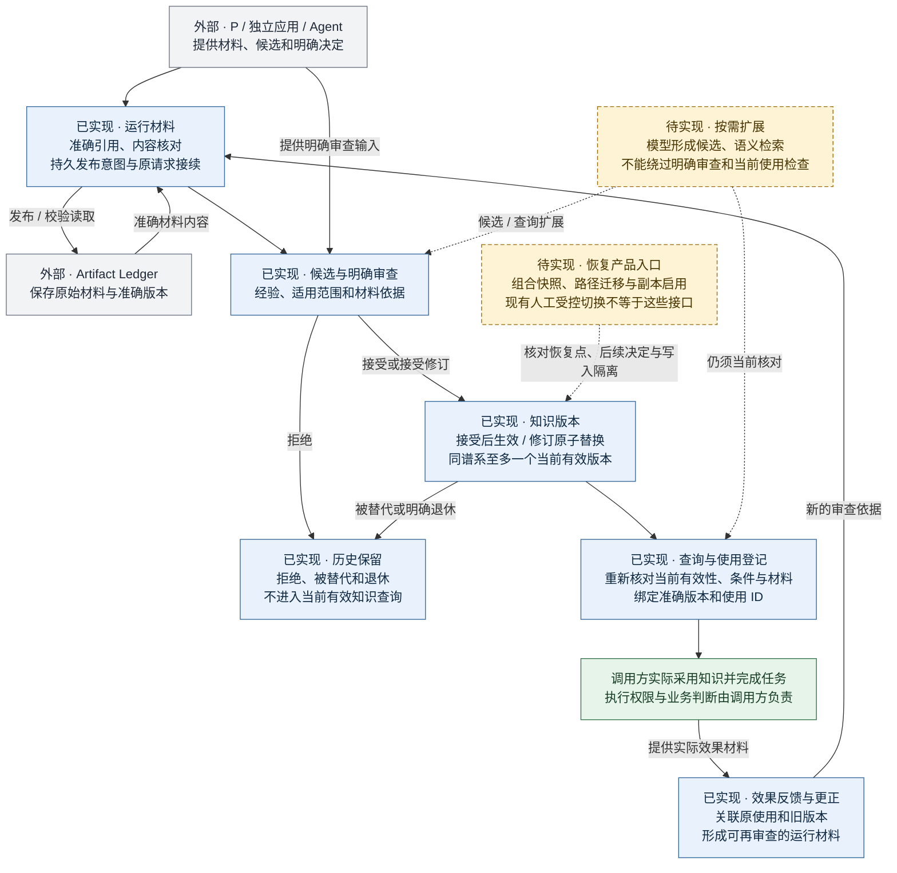

# domain-operational-knowledge-core

可独立复用的运行知识组件，管理经验候选、明确审查、知识版本、实际使用反馈，以及有依据的修订与退休。

它要解决的问题是：**怎样把一次任务的经验，变成以后可以有依据地使用、发现不适用时可以修正的知识。**

**当前版本：`0.1.0a3` alpha · Linux / Python 3.12 · [MIT 许可](LICENSE)。** 已提供独立库与 CLI，支持 Ledger 材料发布/引用、候选与明确审查、有效知识查询、准确版本的使用登记、效果反馈、更正、修订与退休。已完成 P 真实知识采用与反馈、反馈驱动的明确审查修订，以及本地文档交付对新版本的采用和结果回流；已有试点通过只读组合恢复对账，并完成同机原路径的受控启用及恢复后的新采用/反馈。另已完成一次独立本地 Codex 文档任务的准确版本采用、实际发布和反馈，见[独立消费记录](docs/DEVELOPMENT.md#独立本地-codex-文档交付2026-11-03)。真实退休、更多消费者及跨机切换仍在[后续计划](docs/IMPLEMENTATION_PLAN.md)中；当前没有常驻网络服务。

## 它负责什么

| 使用者的问题 | 本组件的职责 |
| --- | --- |
| 这条经验从哪里来？ | 关联运行记录和原始材料的准确版本，保留来源与缺口 |
| 一次成功能直接变成知识吗？ | 先保存候选和适用条件，经明确审查才进入当前可用知识 |
| 当前有哪些适用于这项任务的知识？ | 确定性查询当前有效版本，返回内容、适用范围和审查依据 |
| 任务到底用了哪一版，效果怎样？ | 记录实际使用的准确版本、任务上下文及后续效果 |
| 经验过时或者出现反例怎么办？ | 根据新材料提出修订或退休，保留旧版本与历史使用记录 |

例如，一次构建失败后得到了一条解决办法：先记录失败、处理和结果，再提出带适用环境的经验候选。审查者接受后，调用方可以查询知识、读取准确版本及其材料。调用方登记采用的准确版本，再提交形成运行材料的效果反馈；新材料经审查可以支持修订或退休；查询命中本身不证明已采用或产生效果。

**保存材料、检索命中和任务成功，都不能自动代替知识准入。** 本组件记录明确的审查决定；知识可用也不等于获得执行某项操作的权限。

## 与其他组件的关系

K 已接通 Ledger 公共库的有界材料读写；P 已通过 K 公共库接入查询、准确版本采用及结果反馈。本地 Codex 已在同一受信数据域直接通过 K 公共接口完成一次独立文档交付的采用与反馈；未导入 P，范围见上方记录。

| 组件 | 主要职责与本仓关系 |
| --- | --- |
| **domain-operational-knowledge-core（K）** | 管理运行知识的候选、明确审查、版本、适用范围、使用反馈及修订与退休 |
| [infra-artifact-ledger](https://github.com/kongbu0621/infra-artifact-ledger) | 原始材料存储：K 已通过公共接口保存、读取准确制品版本并核对内容；知识状态由 K 自己保存 |
| [control-production-plane（P）](https://github.com/kongbu0621/control-production-plane) | 已接入的消费者与材料提供方：推进生产任务，采用已准入的准确知识版本，回流原任务结果；已接通明确学习候选的材料发布与投递，准入仍须另行明确审查 |
| [infra-local-hand](https://github.com/kongbu0621/infra-local-hand) | 间接材料来源：执行结果经 P 或其他调用方组织，原件保存到 Ledger 后可被 K 的运行材料引用；K 本身不执行任务，也不要求安装 Local Hand |
| 独立应用或 Agent | 可通过本库/CLI 提交材料、候选和审查，查询知识；登记准确版本的使用与效果，不依赖 P 的内部对象 |

`domain-` 表示这里拥有运行知识的领域对象和状态含义。原始材料内容由 Ledger 保存，知识状态与使用记录由 K 自己保存，任务推进由 `control-` 组件承担。K 和 P 可以独立建设，也可以通过明确接口组合。

## 完整设计与实现状态

图中蓝色节点标注**已实现**的库 / CLI 能力，黄色虚线框标注**待实现**的扩展；灰色是外部职责。主线从材料经过明确审查，到调用方实际使用；反馈回路保留准确版本，不自动把成功经验升级成知识。



修订与退休接口已实现，**真实退休使用验证仍待完成**；更多消费者与跨机切换也仍待验。迟到反馈继续属于原使用版本，不重新激活旧知识。材料在 Ledger 的提交与 K 的提交不是跨库原子事务。

恢复副本先作历史核对，不能只凭快照中的 `ACTIVE` 开放新使用；当前已有同机原路径的人工受控切换记录，但没有组合快照或自动启用产品接口。向量检索、多租户网络服务等仍是按需取舍，不作为现有核心的依赖。设计依据：[架构](docs/ARCHITECTURE.md) · [实施计划](docs/IMPLEMENTATION_PLAN.md)。

## 当前入口

以下命令均以 `operational-knowledge --store DIR` 开始；字段和错误语义见[公共接口](docs/INTERFACE.md)。

| 命令 | 用途 |
| --- | --- |
| `init` | 初始化新的私有知识库，绑定已确认的 Ledger |
| `write --request FILE` | 发布/登记材料、提出候选、明确审查、登记使用与反馈、修订或退休 |
| `query --kind KIND --context FILE` | 查询当前有效且适用的知识，核对实际材料内容 |
| `get --kind KIND --id ID` | 读取指定材料、候选、审查、知识版本、使用、反馈或退休记录及当前观察 |
| `read-material --id ID` | 按材料的准确 Artifact/Version 取回并校验内容 |
| `operation` | 核对原请求的成功回执，与当前状态分开显示 |
| `pending`、`resume` | 检查原材料/反馈发布请求并在中断后接续 |
| `upgrade` | 显式升级旧知识库格式，保留旧记录与待决请求 |

**材料、审查、使用、反馈和版本生命周期已经可运行。** 未审/被拒候选不进入有效知识查询；原件损坏时保留历史决定，拒绝依赖该内容的新准入或查询，不把旧成功回执当作现在可用。

## 开始使用

从源码构建并安装 K 和 Ledger wheel，步骤见[安装与使用](docs/USAGE.md)；尚未发布 PyPI 包。安装后，使用一个不存在的私有目录运行[合成示例](examples/material_to_knowledge.py)：

```sh
.venv/bin/python examples/material_to_knowledge.py /absolute/private/new-knowledge-example
```

它完成材料保存、待审隔离、明确审查、重开知识库和准确材料读回。另有[完整生命周期示例](examples/knowledge_lifecycle.py)，展示准确版本使用、效果回流、审查修订和退休。示例及验证数据均为合成数据，不代表真实生产效果或 Ledger A3 已完成。

## 首版完整目标

1. 原始材料在 Ledger 中保存，运行记录引用准确的 Artifact/Version。
2. 候选引用已有运行记录，声明经验内容及适用范围；待审或被拒候选不进入主动知识查询。
3. 明确审查接受后生成知识版本，查询与使用保留准确版本及依据。
4. 使用效果形成新的运行记录，支持有依据的版本修订或退休；旧记录保持可追溯。

当前实现采用单机、离线优先、一个受信本地数据域，提供独立库与 CLI。已有 P 真实采用、所选试点的只读组合恢复和同机原路径受控启用验证；更多消费者、跨机切换及自动故障转移仍需各自实现或验收。模型生成候选、向量检索、多租户服务和完整数字自我留待实际需要明确后扩展。运行数据保存在调用者指定的私有位置，公开仓库只保存通用文档、代码和合成样例。

## 文档

- [安装与使用](docs/USAGE.md)：独立安装、示例和原请求接续。
- [公共接口](docs/INTERFACE.md)：当前库/CLI、JSON 字段、错误及限额。
- [需求](docs/REQUIREMENTS.md)：使用场景、范围和成功标准。
- [架构](docs/ARCHITECTURE.md)：对象、接口方向、状态和恢复边界。
- [实施计划](docs/IMPLEMENTATION_PLAN.md)：实现顺序与验证方式。

开发过程、阶段记录和任务接续见[开发与接续记录](docs/DEVELOPMENT.md)；参与维护从 [AGENTS.md](AGENTS.md) 开始。
